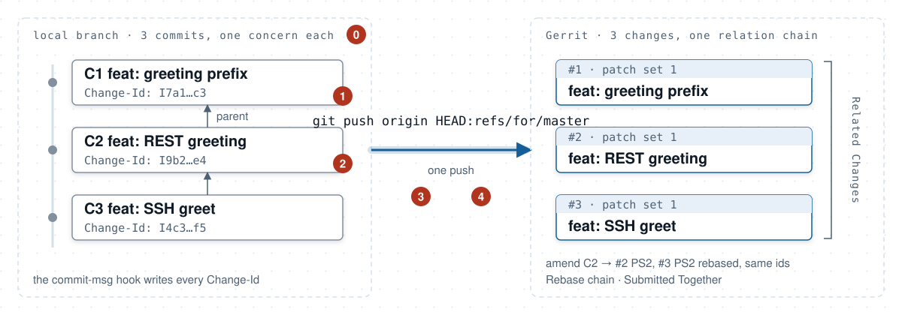
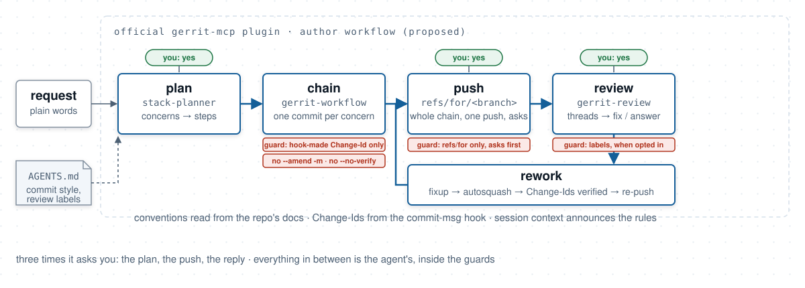
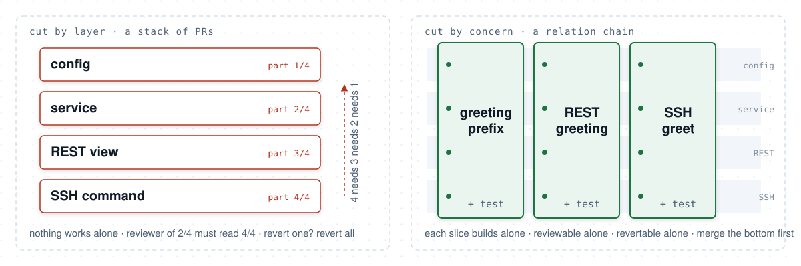

<!-- Slide 1: Title (target 0:30) -->
<!-- _footer: '' -->
<!-- _header: '' -->
<style scoped>
  h1 { font-size: 44px; }
  h3 { font-size: 30px; }
</style>


# How to Stack Changes like a Pro
### Chains that survive. Conventions that stick.


<sub><b>Jacek:</b> hands-on engineer & architect, code reviews daily, Gerrit maintainer</sub>
<!--
Hi, I'm Jacek. I'm a hands-on engineer and architect. I review code every day, and I maintain Gerrit.

Last year we talked about how to do code review like a pro. Today: how to stack changes like a pro.

The answer is simple again. The agent will stack. Your job is to give it the rules and the guards. Then the stack survives rework and it stays reviewable.

[alt subtitles: a. Chains that survive - and conventions the agent keeps. · b. Stacked changes, team conventions, enforced on the agent.]
-->

---

<!-- paginate: true -->
<!-- Slide 2: Last year in one slide (target 0:25) -->
## Last year in one slide

- **Focus the diff.** Small, single-concern changes.
- **Coach with principles.** Conventional Comments, severity labels.
- **Let tools police nits.** Formatters, linters, CI.

#### One year later: more code, same reviewers.

<sub>2025 talk: [How to do Code Review like a Pro](https://youtu.be/7pcb1p3hTtg)</sub>

<!--
Last year I left you with three calls to action: focus the diff, coach with principles, and let tools take care of the nits.

One year later, one developer produces in a day what used to take a week. The reviewers are the same people. Let's see what that did to review.
-->

---

<!-- Slide 3: Mega-PRs faster than review (target 0:40) -->
## Mega-PRs faster than review

- **Faros 2025:** PR size **+154 %**, review time **+91 %**
- **Faros 2026:** time in code review **+200 %**, time to first review **+157 %**
- **LinearB 2026**, 8.1 M PRs: AI PRs **~2.5× bigger**, wait **>16 h** for a reviewer (was ~200 min)
- **Anthropic 2026:** output per engineer **+200 %** - *"code review has become a bottleneck"*
- **GitHub 2026:** a **1,721-line** agent PR → a **4-layer** stack

#### Review is the new bottleneck.

<sub>[Faros 2025](https://www.faros.ai/blog/ai-software-engineering) · [Faros 2026](https://www.faros.ai/blog/ai-acceleration-whiplash-takeaways) · [LinearB](https://linearb.io/blog/8-million-prs-engineering-productivity) · [Anthropic](https://claude.com/blog/code-review) · [GitHub](https://github.blog/engineering/turn-one-giant-ai-generated-pull-request-to-a-reviewable-stack/)</sub>

<!--
Here's the data. Four sources, one picture. Pull requests got bigger, and review got slower. The interesting one is GitHub engineering, in August. One agent pull request, 1,721 lines. Their fix? A stack of four: data, API, grounding and UI.

Anthropic says it in their own words: "code review has become a bottleneck".
-->

---

<!-- Slide 4: Meme (target 0:15) -->
<style scoped>
  blockquote { font-size: 34px; text-align: left; border-left: 6px solid #999; padding-left: 1rem; }
</style>

> Ask a programmer to review **10 lines** of code, he'll find **10 issues**.
>
> Ask him to do **500 lines** and he'll say it **looks good**.

<sub>Giray Özil, [2013](https://x.com/girayozil/status/306836785739210752)</sub>

<!--
And here's why size is the bottleneck.
-->
---

<!-- Slide 5: Welcome to 2008 (target 1:00) -->
## Welcome to 2008

- **2010s** Phabricator at Meta: stacked diffs
- **2022** Meta open-sources **Sapling** + ReviewStack
- **2025-12** **Graphite** acquired by Cursor
- **2026-07** **GitHub stacked pull requests**, public preview, `gh-stack`

#### Gerrit, October 2008: one commit per change, uploaded in series - day one.

<sub>[Gerrit's first commit, 2008-10-21](https://gerrit.googlesource.com/gerrit/+/38966837f9f0b331b3cafa3dccb8b41f8c42c671) · [review.source.android.com, Dec 2008](https://web.archive.org/web/20081202081235/http://review.source.android.com/) · [GitHub preview](https://github.blog/changelog/2026-07-30-stacked-pull-requests-are-now-in-public-preview/) · [Gerrit 3.8](https://www.gerritcodereview.com/3.8.html)</sub>

<!--
So everybody arrives at the same answer: small changes, stacked.

Meta had stacked diffs in Phabricator for over ten years, and in 2022 they open-sourced Sapling. Graphite built a business on stacked pull requests; in December, Cursor bought them. In July, GitHub shipped stacked pull requests as a public preview.

Welcome to 2008. Gerrit 1.0 reviewed the Android Open Source Project from its launch in October 2008. One commit per change, a series of commits reviewed as a chain, on day one. The Change-Id footer came in 2009, and since 3.8 you rebase a whole chain with one click.

And the Change-Id isn't only ours anymore: in 2025, Gerrit, GitButler and Jujutsu agreed to share it.

Now let me show you what a good chain looks like.
-->

---

<!-- Slide 6: What a good chain looks like, in practice (target 1:15) -->
## What a good chain looks like, in practice

<style scoped>
  section { font-size: 25px; }
</style>

- **One concern per change:** builds alone, tests/docs travel with it, CI-green, revertable.
- **Size is a warning, not a target:** a mechanical migration stays one change.
- **Chain length follows the concerns:** merge the bottom as soon as it's approved.
- **The chain outlives the rework:** Change-Ids survive every amend and rebase; restacking is tooling's job.

**Conventions travel with the repo:** the team writes them down (`AGENTS.md`, `CONTRIBUTING`); commitlint and Conventional Comments etc. are examples.

<sub>[SmartBear](https://smartbear.com/learn/code-review/best-practices-for-peer-code-review/): 200–400 lines per sitting · [arXiv 2607.20189](https://arxiv.org/abs/2607.20189): 1/3 of chains restructured, 2.6× slower to merge</sub>

<!--
Four things, plus one rule for the repo.

First, one concern per change. It builds on its own, it carries its tests and docs, it's green in CI, and you can revert it alone.

Second, size is a warning, not a target. SmartBear says 200 to 400 lines per sitting. But a migration or a rename stays one change. Don't cut it to hit a number.

Third, chain length follows the concerns. Any length is fine, as long as the bottom keeps landing.

Fourth, the chain survives the rework. An agent amends and rebases a lot, and every step has to keep the Change-Id. The honest number: in 30,000 Gerrit chains, chain changes merged 2.6 times slower, and a third were restructured in review. Restacking is the price of a chain. Pay it with tooling, not with authors.

And the rule for the repo: conventions travel with it, written down in AGENTS.md. The agent follows the team, not the chat.

That's the target. Here is how an agent misses it.
-->

---

<!-- Slide 7: Where an agent breaks the chain (target 1:15) -->
## Where an agent breaks the chain

<style scoped>
  section { font-size: 21px; }
  h2 { font-size: 38px; }
</style>



⓪ **wrong cut** - layers, halves, merged concerns &nbsp;·&nbsp; ① hand-made Change-Id
② `--amend -m` &nbsp;·&nbsp; ③ `push … refs/heads/*` → no review
④ team conventions missed → a human fixes the chain before the push

<!--
You know this picture. Three commits, one push, three changes in a chain. Amend the middle one, push again: new patch sets, same Change-Ids.

What's new is the author. An agent walks through this many times a day, and it can break it in multiple places.

Number zero, and the biggest, is the cut itself: layers instead of concerns, a concern cut in half, two concerns merged. No guard catches that; only the plan does. More on it at the end.

One: a hand-made Change-Id. One typo, and Gerrit opens a new change, or lands on somebody else's.

Two: amend with dash m. The trailer is gone, and the old change is orphaned with its review.

Three: a push to refs heads instead of refs for. The review is simply skipped or closed.

Four: the team's conventions. Commit style, review labels. The agent follows what it can read; a rule that lives only in a tool's config, it never sees. So a human fixes the message, or labels the comment, before the push. That's a broken chain too, just a quieter one: the agent did the work, and you did the rework.

None of them is free: the agent burns tokens, and a human cleans up.

The pull-request world ships skills for this. None of them is built for Gerrit. The official plugin has a part of it.
-->

---

<!-- Slide 8: The PR world ships agent stacking skills. Gerrit ships half of one. (target 1:05) -->
## The PR world ships agent stacking skills. Gerrit ships half of one.

- *Everyone else:* gh-stack, Graphite, GitButler, Cursor, PostHog, thoughtbot, Codex - all PR-shaped; small single-purpose changes; two plan first; **none asks before the push**.
- *Gerrit:* the official plugin reviews; `gerrit-workflow` knows `refs/for` and chains - no planning, no guards, no push. **The gap.**
- *The proposal:* an **author workflow** for the official plugin - open for review on gerrit-review.

<sub>[gh-stack](https://github.com/github/gh-stack) · [Graphite](https://github.com/withgraphite/agent-skills) · [gerrit-mcp](https://github.com/GerritCodeReview/gerrit-mcp-server)</sub>

<!--
Everybody else already ships something for coding agents. All of it is PR-shaped. GitHub's gh-stack and PostHog have a stacking skill, Graphite a how-to for its CLI, GitButler and Cursor split finished work into PRs. Two of them plan before the code. Most want small, single-purpose changes. Not one asks you before the push. And the word GitHub and PostHog use for a step is "layer".

Gerrit has the official MCP plugin. It's good on the review side, and its gerrit-workflow skill knows refs for and chains. But it has no planning step, no guards and no push step. That's the gap.

So I built the missing half: an author workflow for the official plugin. First as a standalone prototype, then ported upstream, open for your review on gerrit-review. Here it is, one round.
-->

---

<!-- Slide 9: The author workflow, in one round (target 1:50) -->
## The author workflow, in one round

<style scoped>
  section { font-size: 22px; }
</style>



<sub>[the proposal on gerrit-review](https://gerrit-review.googlesource.com/c/gerrit-mcp-server/+/648752)</sub>

<!--
Here's the proposal, end to end.

A plain feature request comes in: three behaviours, no Gerrit words, no "split it" instruction. The planner cuts it into concerns and proposes three steps, one per behaviour. You say yes. That's the first time it asks you.

Then the chain: three commits, one per concern. The Change-Id comes from the commit-msg hook, the subject in the style your repo documents. The guard sits right here: no hand-written Change-Id, no amend dash m, no no-verify.

Then the push. The whole chain, one push, to refs for, and it asks you first. That's the second yes. On the server: three changes, one relation chain.

Then review. A reviewer leaves a blocking comment on the middle change. The review skill reads the threads and drafts the replies. The fix goes in as a fixup, autosquash folds it into the right change, the Change-Ids are checked, and the whole chain is pushed again. The middle change gets patch set two, the one above is rebased, the one below is untouched. Then it shows you the replies and asks. Third yes. Nothing is posted before it.

Three times it asks you: the plan, the push, the reply. Everything in between is the agent's work, inside the guards. And the conventions come from the repo, not from the prompt.

Did it hold beyond one round? I measured it.

[If asked how the other arms reworked: all landed the fix on the right change and kept the Change-Id set; vanilla used rebase -i "edit" + amend --no-edit; MCP-only rewrote the message in a heredoc and re-typed the Change-Id in five of six runs; the plugin: fixup, autosquash, verify-ids.]
-->

---

<!-- Slide 10: The team's rules, enforced on the agent (target 1:55 -->
## Does the chain survive?

<style scoped>
  table { font-size: 18px; }
  section { font-size: 22px; }
  h2 { font-size: 36px; }
  th:nth-child(3), td:nth-child(3) { color: #8a8a8a; }
  tbody tr:nth-child(3), tbody tr:nth-child(3) td { border-bottom: none; }
  tbody tr:nth-child(4), tbody tr:nth-child(4) td { border-top: none; }
</style>

| 3 runs per cell · rework rows pool 2 variants | gerrit-mcp + author workflow | prototype | gerrit-mcp only | vanilla | enforced by |
|---|---|---|---|---|---|
| unprompted runs that produced a chain | **6 / 6** | 6 / 6 | 6 / 6 | 6 / 6 | the model |
| chain starts with a config layer | **0 / 6** | 3 / 6 | 5 / 6 | 6 / 6 | the planner |
| rework all green | **5 / 6** | 6 / 6 | 1 / 6 | 5 / 6 | skill rule |
| ↳ the misses: a Change-Id re-typed by hand | **1 / 6** | 0 / 6 | 5 / 6 | 1 / 6 | guard + hook |
| labelled comments (opt-in) | **16 / 16** | 19 / 19 | 0 / 16 | 6 / 18 | `AGENTS.md` |

<sub>[gerrit-stack](https://github.com/geminicaprograms/gerrit-stack) · [benchmark](https://github.com/geminicaprograms/gerrit-stack/blob/main/docs/benchmark.md)</sub>

<!--
A hundred and twenty sandboxed runs. Same model, same prompts, four arms: vanilla, the official plugin, the prototype, and the official plugin with the author workflow. Three runs per cell, so one run of difference is noise.

First surprise: every arm splits the work into chains. Six of six unprompted runs, in every arm. Even vanilla Claude Code pushed a chain without being asked. The model learned that. Now look at the cut. Vanilla started all six chains with a config change - "add the setting" - then the service, then the views; the plugin-only arm five of six; in three of those runs the REST view and the SSH command landed in one change. The author workflow started none of its six chains with config: REST, SSH, ping, one behaviour per change, the setting inside the change that needs it. So stacking is there; we need to tune it to cut better, and in keep the chain.

The difference is the rework. Six changes, a blocking comment on change three, and the fix conflicts with change five.

The chain survived in every arm; the difference is how. One thing to notice: I count a re-typed Change-Id as a miss even when the value was right. The agent should never type it. One typo, and the review is orphaned, as we saw on slide seven. With the author workflow, five of six runs were green on every check; the one miss is on my list to tighten. The prototype six, MCP-only one, vanilla five.

And review comments, where the repo says "use Conventional Comments": the author workflow labelled sixteen of sixteen. MCP-only: none.

Within noise, the author workflow keeps what the prototype measured.

[If asked: D ran 13 days after A–C, Claude Code 2.1.302 vs 2.1.289; the seven qualification evals score 6/7 for both on today's CLI. Commitlint showed no difference: every arm's subjects passed it; its value is catching drift.]

[If asked about the "squash it" variant: half the rework runs also got the advice "amend with -m and squash the rest". Nobody squashed, in any arm. Vanilla and the plugin-only arm each took the -m once in three nudged runs; vanilla also used -m once unprompted. The two plugin arms never did; the guard denies it.]

[If asked: the benchmark also has a "skip the hook with no-verify" variant; left out - a hook is not slow - numbers in the repo.]
-->

---

<!-- Slide 11: Cut by concern, not by layer (target 2:05) -->
## Cut by concern, not by layer

<style scoped>
  section { font-size: 22px; }
</style>



<sub>Small isn't the goal. Judgeable alone is: review, verify, land, revert.</sub>

<!--
Back to break number zero, the one no guard can catch: the cut.

Take the request on top: three behaviours. Left side, cut by layer: config, then the service, then REST, then SSH. Part one of four. Small changes - and exactly what gh-stack and PostHog teach. Remember GitHub's stack of four from the start? Not one of those four is a feature. That's the cut the PR tools teach, and it looks tidy right up to the review.

So what's wrong with that, if small is what we want? Small isn't the goal. Reviewer time is the bottleneck, and a reviewer spends it per change. A layer can't be judged alone: to review the service you read the REST view. It can't be verified alone: the tests arrive in part four. It can't land alone: nothing works until four of four, so it's the big change in four pieces, plus the rebase churn. And a comment on behaviour touches every layer: four patch sets instead of one fixup. Small on the screen, big for the reviewer.

Right side, cut by concern: the REST greeting with its setting, the SSH command, the per-project override. Each slice is one behaviour - code, caller, test - through every layer it touches. It builds alone, reads alone, lands alone. The SSH command and the override even revert alone; the layer stack reverts all or nothing. A concern is what a reviewer can judge in one sitting. That's the unit. Copy the stacking, not the cut.

This is the plan the author workflow proposes: one behaviour per change, test inside, and you approve it - the first yes. In the benchmark it never opened a chain with a config layer. Vanilla did, six of six.

Two more wrong cuts. By size: a big slice is a warning for the reviewer, not a reason to halve it. By merging, because someone says "just squash it": a fix goes in as a fixup, into the change it belongs to.

Everything else on the slide-seven list is cheap - a guard denies it or asks. The cut is yours and the planner's. Small isn't the goal. Judgeable alone is.

[If asked, the request on the slide, verbatim from the plan tests: "We want demo-plugin to greet a project the same way it already answers ping. 1. REST: GET /projects/{name}/demo-plugin~greeting returns {"greeting":"<prefix>, <project>!"}; the prefix comes from [plugin "demo-plugin"] greetingPrefix in gerrit.config, default Hello. 2. SSH: demo-plugin greet <project> prints the same greeting. 3. A project can override the prefix in its own project.config; the server value stays the default. When it is done, push the work to Gerrit for review." No Gerrit words beyond the last line, no "split it". The planner cut it into the three slices on the right, in the prototype and in the author workflow alike; vanilla pushed three changes too, config first.]
-->

---

<!-- Slide 12: Summary & call to action (target 1:30) -->
## Summary & call-to-action
#### The agent will stack. Cut by concern. Keep the chain. Follow the team.

<style scoped>
  section { font-size: 25px; }
  h4 { font-size: 28px; }
  .left-align { text-align: left }
  pre > code { font-size: 15px; }
</style>
<div class="left-align"><b>By next Friday:</b></div>

- Install the **author workflow**: three lines below.
- Try it on **one real feature**: before the first yes, check that every step is one concern.
- Add **two rules** to the `AGENTS.md` you already have: commit style, review labels.

```
git clone https://gerrit.googlesource.com/gerrit-mcp-server && cd gerrit-mcp-server
git fetch origin refs/changes/52/648752/4 && git checkout FETCH_HEAD
claude plugin marketplace add "$PWD" && claude plugin install gerrit@gerrit-mcp   →   /gerrit:setup
```

<sub>Thanks! [slides](https://geminicaprograms.github.io/code_review_like_a_pro/stack/) · [the proposal on gerrit-review](https://gerrit-review.googlesource.com/c/gerrit-mcp-server/+/648752) · [benchmark](https://github.com/geminicaprograms/gerrit-stack/blob/main/docs/benchmark.md) · [Discord](https://discord.gg/eEZQrtzAwV)</sub>

<!--
Let me put it in one line. [point at the subtitle] The agent will stack. Your job is to ensure that it will: cut by concern, keep the chain, follow the team.

So, by next Friday, three things to do.

One: install the author workflow. Three lines, on the slide.

Two: try it on one real feature. Before you say the first yes, read the plan. Is every step one concern? If not, move a line.

Three: open the AGENTS.md you already have, and add two rules: your commit style and your review labels.

One more thing. The chain is open for review as of today. Review it like any other chain. All comments are welcome, on the changes or on Discord. Thank you.

[The fetch line points at patch set 4 of the tip change, 648752 (rebased onto master 2026-10-27, 2026-11-02 and 2026-11-07; set_hashtags merged, thread links unchained). A new patch set changes the /4. The change is private until you flip it; flip it before the talk, or the room gets a 404. The "try it yourself" page carries the long form incl. uv sync.]
-->
